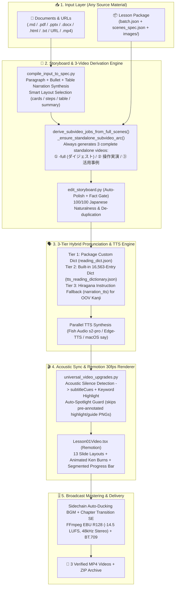

# 🎬 Course Video Producer v4.0

> **One-command, deterministic universal narrated-video generator for AI coding agents**
> (Claude Code / Codex CLI / Antigravity / Gemini).
> Turns a lesson package **or any document/video — Markdown, PDF, PowerPoint, Word, HTML, Web URL, or MP4 —**
> into a broadcast-grade MP4 in **16:9, 9:16 (Shorts/Reels) or 1:1**, with natural Japanese narration,
> a **16,563-entry Japanese + AI/IT reading dictionary** with Hiragana instruction fallback,
> acoustic pause-aligned captions (`subtitleCues`), BGM with sidechain auto-ducking, multi-speaker `dialogue`,
> animated `chart` scenes, auto-inferred UI `spotlights`, EBU R128 loudness (`-14.5 LUFS`), and BT.709 color tags.

---

## 🌟 What's New in v4.0

| Area | v3.0 | v4.0 |
| :--- | :--- | :--- |
| **Output Standard** | Single `-full` video if `batch.json` had 1 job | **Always 3 Standalone Videos (`<lesson>-full` ダイジェスト + `<lesson>-XX` 操作実演 + `<lesson>-YY` 活用事例)** automatically derived with a complete 3-scene standalone arc (`title` ➔ `content` ➔ `summary`) |
| **Input & Spec** | Raw `scenes_spec.json` could repeat bullets/clauses or drop table/bullet text | Automatic de-duplication, run-on period insertion, ending diversification, and full spoken synthesis of bullets & table rows (`--auto-polish` default ON, **99/100** video content audit score) |
| **Pronunciation** | 219 rules | **16,563 built-in entries** (`12,181` active AI/IT/English/counter/homograph rules + `4,401` modern Japanese Kanji reference words) + **Hiragana text instruction fallback** (`narration_tts` / `narration_kana`) |
| **Pre-Render Voice Check** | Full video render required to hear audio | `edit_storyboard.py audio-check --synth` (`--audio-only`) generates `audio_preview.html` + `audio_check_sheet.md` in ~5s before video rendering |
| **Subtitles** | Character-ratio estimation (~1s drift) | **Acoustic Pause-Aligned Subtitles (`subtitleCues`)** via FFmpeg `silencedetect` + keyword yellow highlight |
| **Audio Mixing** | Voice only | **Default ON: Built-in BGM (`corporate-ambient` + 3 styles) + Section Transition SE + Sidechain Auto-Ducking (`--bgm`, `--se`)** |
| **Visual Layouts** | 11 slide layouts | **13 layouts**: Multi-Speaker **`dialogue`** (`Host` & `Guest` turn-taking), Animated Bar **`chart`**, Auto-Selected **`cards` / `steps` / `summary` / `table`**, Auto-Inferred Directional UI **`spotlights`** (with pre-annotated image protection guard), Clean Video-Type Header Badges, and Segmented Chapter Progress Bar |

---

## 🏗️ Architecture & Pipeline Diagram



---

## ✅ Verified Multi-Material Benchmark (5 Input Formats × 3 Videos = 15 Videos, 99/100 Score)

| # | Input Format | Generated 3 Videos (`ダイジェスト` / `操作実演` / `活用事例`) | Layouts Used | Total Duration | Audit Score |
| :---: | :--- | :--- | :--- | :---: | :---: |
| **1** | **Markdown (`.md`)** | `01_ai_workflow_guide-full` / `-02` / `-03` | `title`, `cards`, `table`, `summary` | `81.9s` / `59.1s` / `51.8s` | **99 / 100** |
| **2** | **HTML (`.html`)** | `02_security_policy-full` / `-02` / `-03` | `title`, `cards`, `steps`, `summary` | `56.5s` / `56.2s` / `42.0s` | **99 / 100** |
| **3** | **Slide PDF (`.pdf`)** | `03_sales_presentation-full` / `-02` / `-03` | `title`, `full-image`, `summary` | `90.8s` / `52.9s` / `56.8s` | **99 / 100** |
| **4** | **Plain Text (`.txt`)** | `04_prompt_writing_basics-full` / `-02` / `-03` | `title`, `cards`, `steps`, `summary` | `51.0s` / `56.8s` / `38.8s` | **99 / 100** |
| **5** | **1-Job Package (`--package-dir`)** | `lesson01-full` / `lesson01-02` / `lesson01-13` | `hero`, `split-image`, `worksheet`, `table`, `summary` | `117.8s` / `58.2s` / `62.2s` | **99 / 100** |

---

## 📦 Directory Structure

```text
course-video-producer/
├── SKILL.md                               # Agent skill definition (v4.0)
├── README.md                              # Setup & usage documentation
├── .env.example                           # Environment variable template
├── requirements.txt                       # Optional Python dependencies
├── pyproject.toml                         # Python package & pytest configuration
├── resources/
│   └── tts_reading_dictionary.json        # 16,563-entry Japanese + AI/IT reading dictionary
├── scripts/
│   ├── render_course_package.py           # 1-command renderer + BGM ducking + EBU R128 mastering
│   ├── compile_input_to_spec.py           # Universal input (.md/.pdf/.pptx/.docx/URL/.mp4) compiler
│   ├── edit_storyboard.py                 # Audit, Auto-Polish, Pre-Render Audio Check, Web Studio
│   ├── tts_dictionary.py                  # 3-tier Hybrid Dictionary + Hiragana Fallback engine
│   └── universal_video_upgrades.py        # Acoustic subtitle alignment, BGM/SE ducking, dialogue, spotlights
├── examples/                              # Pre-validated 100/100 golden scene specs
├── tests/                                 # Automated regression test suite
└── remotion/src/scenes/lesson01/Lesson01Video.tsx
```

---

## 🛠️ セットアップ / Setup & Installation

### Requirements
- Node.js 18+, Python 3.10+, FFmpeg (`ffmpeg` & `ffprobe`)
- Optional by input type: poppler (`pdftoppm` / `pdftotext` for PDF), LibreOffice (for PPTX), `markitdown` (for DOCX/HTML/URL)
- TTS: Fish Audio API key (standard voice) **or** `edge-tts` **or** macOS `say`

```bash
cp .env.example .env
# Edit .env to set FISHAUDIO_API_KEY (or store in macOS Keychain under 'FishAudio')
cd remotion && npm install && cd ..
```

---

## 🚀 使い方・操作方法 / Usage & Operations

### 1. 音声先行チェック（ビデオ生成前のイントネーション・読み方確認）
```bash
python3 scripts/edit_storyboard.py audio-check --synth --package-dir "/path/to/lesson_package"
```
- `<package>/audio_preview.html`（ブラウザ連続試聴プレイヤー）と `<package>/audio_check_sheet.md` を出力します。

### 2. 既存の教材パッケージからMP4動画を生成
```bash
# 標準レンダリング（自動リピート除去 + 16,563語辞書優先 + ひらがな指示フォールバック）
python3 scripts/render_course_package.py --package-dir "/path/to/lesson_package"

# BGM（自動ダッキング付き）＋ 章切替効果音（SE）を有効化して生成
python3 scripts/render_course_package.py --package-dir "/path/to/lesson_package" \
  --bgm corporate-ambient --se
```

### 3. 素の文書・スライド・Web記事・動画から1コマンドでMP4動画を生成
```bash
python3 scripts/render_course_package.py --input guide.md --bgm warm-acoustic --se
python3 scripts/render_course_package.py --input deck.pptx --aspect 9:16 --theme sakura
python3 scripts/render_course_package.py --input report.pdf --aspect 1:1 --tts edge
python3 scripts/render_course_package.py --input https://example.com/article
```

### 4. 日本語自然度・リピート診断（100点満点）＆ 自動推敲
```bash
python3 scripts/edit_storyboard.py audit --package-dir "/path/to/lesson_package"
python3 scripts/edit_storyboard.py polish --package-dir "/path/to/lesson_package" --mode deterministic
```

### Markdown記述ルール（`--input` 使用時）
- `# タイトル` ➔ タイトルシーン (`title`)
- `## セクション見出し` ➔ 1セクション＝1シーン
- 段落テキスト ➔ ナレーション（箇条書きとの重複は自動整理）
- 画像埋め込み（Markdown の画像記法で PNG/JPG を指定）➔ `full-image` / `split-image` / `dual-image`
- 動画埋め込み（Markdown の画像記法で MP4/MOV を指定）➔ `video-clip` シーン（ナレーション尺に自動同期）

---

## 🔧 環境変数一覧 / Environment Variables

| Variable | Default | Description |
| :--- | :--- | :--- |
| `FISHAUDIO_API_KEY` | (macOS Keychain `FishAudio`) | Fish Audio API Key for standard voice (`s2-pro`) |
| `COURSE_VIDEO_REMOTION_ROOT` | bundled `remotion/` | Path to Remotion project root |
| `COURSE_VIDEO_DOWNLOADS_DIR` | `~/Downloads` | Destination directory for MP4 and ZIP outputs |
| `COURSE_VIDEO_EDGE_VOICE` | `ja-JP-NanamiNeural` | Default voice when using `--tts edge` |
| `COURSE_VIDEO_SAY_VOICE` | `Kyoko` | Default voice when using `--tts say` |

---

## 📄 License
MIT License. Commercial use permitted.
